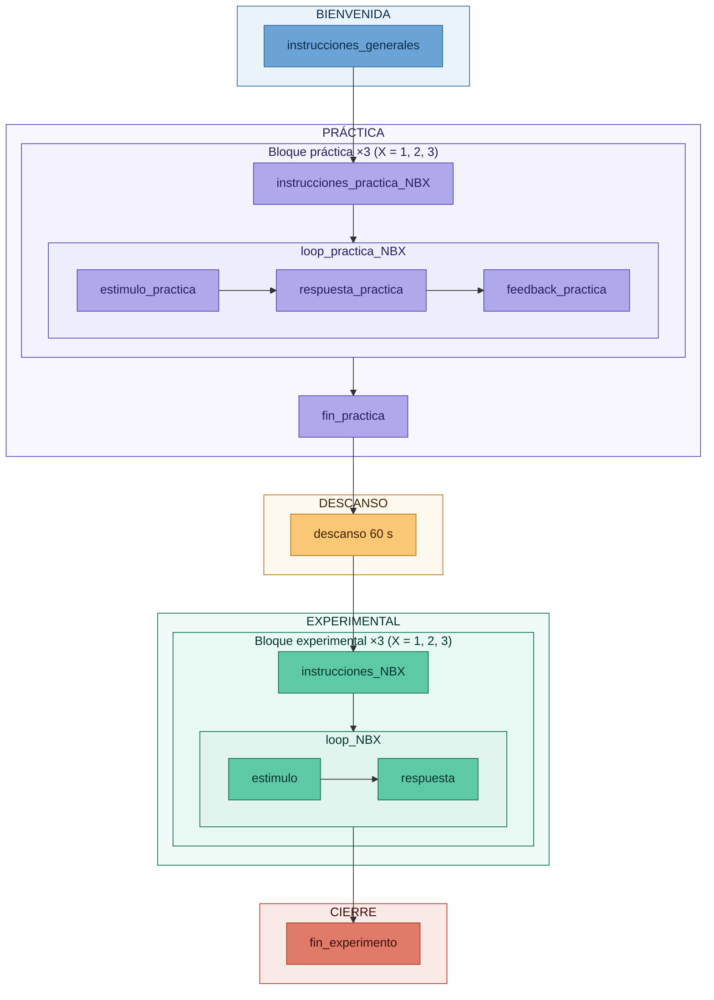

# Taller 3 — Tarea N-Back

- **Asignatura:** Investigación e Intervención desde las Neurociencias Aplicadas  
- **Ciclo:** 2026-1  
- **Autor:** Marcelo Landa

---

## Descripción

Materiales del Taller 3 del curso, centrado en el diseño e implementación de la tarea N-Back en PsychoPy Builder. La tarea sigue el paradigma N-back introducido por Kirchner (1958), e incluye tres niveles de dificultad (1-back, 2-back y 3-back) con secuencias de letras pre-generadas. Huang et al. (2025) es la revisión de referencia utilizada en el taller.

> **Nota:** El archivo `.psyexp` será completado durante el taller. Al finalizar la semana se subirá la versión resuelta a este repositorio.

---

## Cómo descargar los materiales

1. Hacer clic en el botón verde **`< > Code`** en la parte superior de esta página
2. Seleccionar **`Download ZIP`**
3. Descomprimir el archivo en tu computadora
4. Abrir PsychoPy Builder y cargar el archivo `nBack_task.psyexp`

> **Importante:** No mover ni renombrar ninguna carpeta. PsychoPy necesita encontrar los archivos exactamente en las rutas que se configurarán durante el taller.

---

## Estructura del repositorio

```
taller_3_memoria/
│
├── nBack_task.psyexp                   # Archivo del experimento (se completa en el taller)
│
├── conditions/
│   ├── experimental/
│   │   ├── condiciones_experimental_1back.xlsx     # 20 trials — 1-back experimental
│   │   ├── condiciones_experimental_2back.xlsx     # 20 trials — 2-back experimental
│   │   └── condiciones_experimental_3back.xlsx     # 20 trials — 3-back experimental
│   └── practica/
│       ├── condiciones_practica_1back.xlsx         # 8 trials — 1-back práctica
│       ├── condiciones_practica_2back.xlsx         # 8 trials — 2-back práctica
│       └── condiciones_practica_3back.xlsx         # 8 trials — 3-back práctica
│
├── docs/
│   ├── instrucciones_nback.docx        # Instrucciones por pantalla con notas técnicas
│   └── guia_materiales_taller3.docx   # Guía completa de materiales del taller
│
└── README.md
```

---

## Diseño de la tarea

| Parámetro | Valor |
|---|---|
| Paradigma | N-back verbal con letras mayúsculas |
| Letras | B D F G H J K M P Q R T V W (14 letras) |
| Niveles | 1-back, 2-back y 3-back |
| Teclas de respuesta | L (coincide — target) · A (no coincide — non-target) |
| Trials de práctica | 8 por nivel (3 targets, 5 non-targets) |
| Trials experimentales | 20 por nivel (6 targets, 14 non-targets — 30% targets) |
| Duración del estímulo | 500 ms |
| Ventana de respuesta | 2000 ms (forceEndRoutine = True) |
| Feedback | Solo en fase de práctica |
| Variables de la tarea | Precisión (% correcto) y RT (ms) por nivel |

> **Importante:** El loop de cada bloque debe configurarse con `loopType = sequential`. No aleatorizar — el orden de la secuencia es crítico para la lógica N-back.

### Flujo de la tarea



---

## Análisis de resultados

Una vez completada la tarea, el CSV generado por PsychoPy puede procesarse en la aplicación web del curso:

**🔗 [mlandaf.github.io/taller_3_resultados](https://mlandaf.github.io/taller_3_resultados)**

No se requiere instalar ningún software adicional. Solo arrastra tu archivo CSV al navegador.

---

## Referencias

Huang, S., Chen, C., Mo, Y., Zhao, Y., Zhu, Y., Dong, K., & Xu, T. (2025). Exploring the n-back task: insights, applications, and future directions. *Frontiers in Human Neuroscience, 19*, 1721330. https://doi.org/10.3389/fnhum.2025.1721330

Kirchner, W. K. (1958). Age differences in short-term retention of rapidly changing information. *Journal of Experimental Psychology, 55*(6), 535-541. https://doi.org/10.1037/h0043688

Peirce, J. W., Gray, J. R., Simpson, S., MacAskill, M. R., Hochenberger, R., Sogo, H., Kastman, E., & Lindelov, J. (2019). PsychoPy2: Experiments in behavior made easy. *Behavior Research Methods*. https://doi.org/10.3758/s13428-018-01193-y

---

## Contacto

**Marcelo Landa**  
Asistente de cátedra — Investigación e Intervención desde las Neurociencias Aplicadas  
Universidad de Lima
