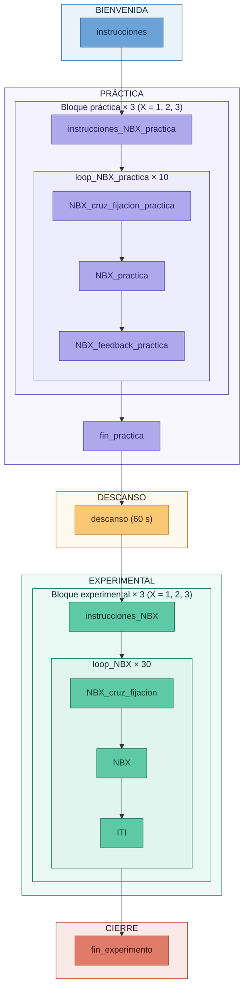

# Taller 3 - Tarea n-back

- **Asignatura:** Investigación e Intervención desde las Neurociencias Aplicadas
- **Ciclo:** 2026-2
- **Autor:** Marcelo Landa

---

## Descripción

Este repositorio contiene los **materiales del Taller 3** del curso, centrado en el diseño e implementación de una tarea n-back con letras en PsychoPy Builder. Durante el taller construiremos la tarea con tres niveles: **1-back, 2-back y 3-back**, respuestas mediante teclado y secuencias de letras previamente definidas. El antecedente del paradigma es Kirchner (1958), y su descripción se apoya en Redick y Lindsey (2013).

> **Nota:** El archivo `nBack_task.psyexp` está vacío y se completará en conjunto durante el taller. Las hojas de condiciones, las instrucciones y las figuras están disponibles como materiales de apoyo.

### Secuencia del ensayo de práctica


**Cruz de fijación (500 ms) → Letra y respuesta (hasta 2000 ms) → Feedback (1000 ms).**

### Secuencia del ensayo experimental


**Cruz de fijación (500 ms) → Letra y respuesta (hasta 2000 ms) → ITI en blanco (500 ms).**

La primera respuesta válida termina la presentación de la letra y da paso al feedback o al ITI. Si no hay respuesta, la presentación termina al alcanzar los 2000 ms.

---

## Cómo descargar los materiales

1. Hacer clic en el botón verde **`< > Code`** en la parte superior de esta página.
2. Seleccionar **`Download ZIP`**.
3. Descomprimir el archivo en tu computadora.
4. Abrir PsychoPy Builder y cargar `nBack_task.psyexp`.
5. Completar la tarea durante el taller, siguiendo la explicación del docente.

> **Importante:** Conservar los nombres de los archivos y la estructura de carpetas. PsychoPy utiliza rutas relativas para encontrar las hojas de condiciones.

---

## Estructura del repositorio

```text
taller_3_memoria/
├── nBack_task.psyexp                         # Experimento vacío (se completa en el taller)
├── conditions/
│   ├── practica/                            # 10 ensayos por nivel
│   │   ├── condiciones_practica_1back.xlsx
│   │   ├── condiciones_practica_2back.xlsx
│   │   └── condiciones_practica_3back.xlsx
│   └── experimental/                        # 30 ensayos por nivel
│       ├── condiciones_experimental_1back.xlsx
│       ├── condiciones_experimental_2back.xlsx
│       └── condiciones_experimental_3back.xlsx
├── docs/
│   └── instrucciones_nback.docx              # Instrucciones
├── media/
│   ├── estructura_experimento.png           # Diagrama del flujo
│   ├── secuencia_practica.png
│   └── secuencia_experimental.png
└── readme.md
```

Una vez implementada y ejecutada la tarea, PsychoPy generará la carpeta `data/` con los archivos de resultados.

---

## Diseño de la tarea

| Parámetro | Valor |
|---|---|
| Paradigma | n-back con letras presentadas visualmente, una a una |
| Estímulos | 14 letras mayúsculas: B D F G H J K M P Q R T V W |
| Niveles | 1-back, 2-back y 3-back |
| Target | La letra actual coincide con la presentada n posiciones antes |
| No target | La letra actual no coincide con la presentada n posiciones antes, o pertenece a las primeras n presentaciones |
| Teclas de respuesta | **L:** coincide (target). **A:** no coincide (no target) |
| Ensayos de práctica | 10 por nivel: 3 targets y 7 no targets, con feedback. Total: 30 ensayos |
| Ensayos experimentales | 30 por nivel: 9 targets y 21 no targets. Total: 90 ensayos |
| Proporción de targets | 30 % de las presentaciones de cada nivel, tanto en práctica como en experimental |
| Cruz de fijación | 500 ms antes de cada letra |
| Letra y respuesta | Hasta 2000 ms, con respuesta mientras la letra permanece visible |
| Feedback | 1000 ms, únicamente en práctica |
| ITI | 500 ms en blanco, únicamente en la fase experimental |
| Descanso | 60 s entre la práctica y la fase experimental |

Las primeras **n** letras de cada nivel se mantienen en memoria, pero todavía no tienen una letra de referencia para comparar. Se responde **A**. La comparación comienza en la segunda letra para 1-back, la tercera para 2-back y la cuarta para 3-back.

> **Orden de las condiciones:** Los loops leen las filas en orden **secuencial**, una sola vez. No aleatorizar las hojas de condiciones: cambiar el orden altera las coincidencias y las respuestas correctas de la secuencia.

### Flujo de la tarea



El diagrama muestra el flujo que construiremos durante el taller, organizado en cinco fases: **bienvenida, práctica, descanso, experimental y cierre**. La práctica y la fase experimental recorren los tres niveles de n-back. En el diagrama, **X representa 1, 2 o 3**.

---

## Análisis de resultados

Una vez implementada y ejecutada la tarea, el CSV generado por PsychoPy en `data/` podrá procesarse en la aplicación web del curso:

**[Abrir la aplicación de resultados del Taller 3](https://mlandaf.github.io/taller_3_resultados)**

Carga tu archivo CSV en el navegador y confirma las columnas de la fase experimental. No necesitas instalar software adicional para utilizar la aplicación.

La aplicación muestra cinco medidas para cada nivel de n-back:

| Medida | Qué describe |
|---|---|
| Precisión global (%) | Proporción de respuestas correctas en el conjunto de ensayos |
| RT correcto (ms) | Tiempo de respuesta promedio de las respuestas correctas |
| Omisiones (%) | Proporción de ensayos sin respuesta |
| Aciertos en targets (%) | Proporción de targets detectados correctamente |
| Falsas alarmas (%) | Proporción de no targets identificados erróneamente como targets |

Se analizan únicamente los **30 ensayos experimentales de cada nivel**, incluyendo las primeras n presentaciones. La práctica se excluye del análisis. Las omisiones cuentan como respuestas incorrectas y no aportan tiempo de respuesta. El RT se interpreta **junto con la precisión**.

---

## Referencias

Kirchner, W. K. (1958). Age differences in short-term retention of rapidly changing information. *Journal of Experimental Psychology, 55*(4), 352–358. https://doi.org/10.1037/h0043688

Peirce, J., Gray, J. R., Simpson, S., MacAskill, M., Höchenberger, R., Sogo, H., Kastman, E., & Lindeløv, J. K. (2019). PsychoPy2: Experiments in behavior made easy. *Behavior Research Methods, 51*(1), 195–203. https://doi.org/10.3758/s13428-018-01193-y

Redick, T. S., & Lindsey, D. R. B. (2013). Complex span and n-back measures of working memory: A meta-analysis. *Psychonomic Bulletin & Review, 20*(6), 1102–1113. https://doi.org/10.3758/s13423-013-0453-9

---

## Contacto

**Marcelo Landa**

Asistente de cátedra - Investigación e Intervención desde las Neurociencias Aplicadas

Universidad de Lima
